<p align="center">
  
</p>

<h1 align="center">Tagteam</h1>

<p align="center">
  Switch your <b>Claude Code</b> and <b>Codex</b> accounts from the macOS menu bar, grouped into profiles.
</p>

<p align="center">
  <a href="https://github.com/sfolador/Tagteam/releases/latest"></a>
  
  
  
</p>

---

When one account hits its usage limit, tag in a fresh one. Tagteam keeps a backup of every account you add and swaps it in with one click. You never have to log out, run the browser login again or use a terminal.

## Features

- **Claude Code and Codex in one place.** Each account shows its 5-hour and weekly limits. The account in use is at the top of its group, and every other account has a **Switch** button and a ⋯ menu (rename, re-authenticate, exclude from auto-switch, profiles, remove).
- **Profiles.** Group accounts into profiles such as *Personal* and *Work*. Picking a profile makes one Claude Code and one Codex account live at once, and limits the list and auto-switch to that profile. An account can belong to several profiles.
- **Auto-switch.** When the Claude Code account in use reaches your threshold (90% by default), Tagteam switches to the account in the profile with the most quota left. A 5-minute cooldown prevents bouncing, and you can opt individual accounts out.
- **Costs at a glance.** API-equivalent cost for today, 7 days and 30 days, plus the last 14 days, all computed from your local Claude Code logs.
- **Menu bar modules and widgets.** Choose what the menu bar shows (account, session or weekly usage, cost, reset countdowns), and add desktop widgets in three sizes.
- **Login without a terminal.** Add accounts through the browser login of the official CLIs, or import the login you already have.
- **Private by default.** Emails are masked unless you choose to show them.
- **Native.** SwiftUI, light and dark mode. Available in English, 简体中文, 日本語, Deutsch and Français.

## Install

1. Download `Tagteam-x.y.z.zip` from the [latest release](https://github.com/sfolador/Tagteam/releases/latest).
2. Unzip it and move **Tagteam.app** to `/Applications`.
3. Open it. The app is signed with a Developer ID and notarized by Apple, so it opens without Gatekeeper warnings.

The first time Tagteam reads the Claude Code credentials, macOS asks for keychain access; choose **Always Allow**.

Requirements: macOS 14 or later, plus the [Claude Code CLI](https://docs.claude.com/en/docs/claude-code) and/or the [Codex CLI](https://github.com/openai/codex).

**Upgrading from CCSwitcher:** Tagteam keeps the same bundle identifier, so your accounts, profiles and settings carry over. Quit CCSwitcher, install Tagteam, and delete the old app.

## How switching works

### Claude Code

- Every account you add is backed up: its OAuth token plus the matching `oauthAccount` block from `~/.claude.json`.
- A switch writes the target account into the `Claude Code-credentials` keychain item and into `~/.claude.json`. Nothing is logged out, so you can switch back at any time.
- Claude Code's keychain item is read through `/usr/bin/security`, so after a single "Always Allow" background reads are silent.
- Expired access tokens are refreshed by the official CLI (`claude auth status`), not by calling Anthropic's private OAuth endpoint.

### Codex

- A switch swaps `~/.codex/auth.json`, written atomically with mode `0600`. Each account's file is kept verbatim in the keychain item `CCSwitcher-codex-backups`.
- Before overwriting the file, Tagteam saves its current contents into the backup of the account that owns them. That account is matched by ChatGPT user and workspace. If the file holds a login Tagteam doesn't manage, the switch stops instead of discarding it.
- Recent Codex versions keep the login in memory, in the `codex app-server` daemon and in the ChatGPT (Codex) desktop app. On every switch Tagteam closes both gracefully, swaps the file, then starts them again, but only if they were running. You can turn this off in Settings → Codex.
- Tagteam never refreshes the tokens of the live Codex account, because refresh tokens are single-use and belong to the CLI. Only stored accounts are refreshed, and the new tokens are saved before use.
- Interactive `codex` sessions that are already open keep their account until you restart them; the popover shows how many are running.

## Build from source

The Xcode project is generated from `project.yml` with [XcodeGen](https://github.com/yonaskolb/XcodeGen).

```bash
brew install xcodegen
xcodegen generate
# Local, ad-hoc signed build
xcodebuild -project CCSwitcher.xcodeproj -scheme CCSwitcher -configuration Release \
  CODE_SIGN_IDENTITY=- CODE_SIGN_STYLE=Manual DEVELOPMENT_TEAM= build
```

To build, sign with a Developer ID, notarize and staple in one step, use `scripts/notarize.sh` (see [BUILD_GUIDE.md](BUILD_GUIDE.md)):

```bash
OUT=/tmp/tagteam-release SRC=$PWD scripts/notarize.sh
```

The Xcode target, scheme and source folders keep the original `CCSwitcher` name; only the product is called Tagteam. See [ARCHITECTURE.md](ARCHITECTURE.md) for the token flows.

## Credits

Tagteam is a fork of [CCSwitcher](https://github.com/XueshiQiao/CCSwitcher) by Xueshi Qiao. Codex support is modelled on [Codex Switcher](https://github.com/Lampese/codex-switcher) by Lampese. Several macOS menu-bar techniques come from [CodexBar](https://github.com/steipete/CodexBar).

## License

[MIT](LICENSE). CCSwitcher and Codex Switcher are MIT-licensed too; their copyright notices are kept in the LICENSE file.
